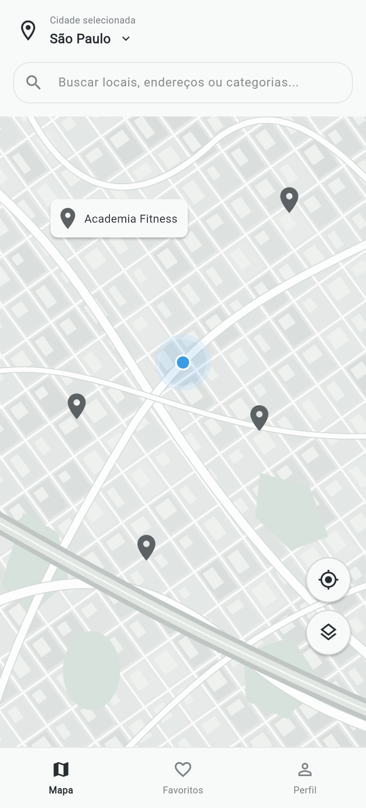
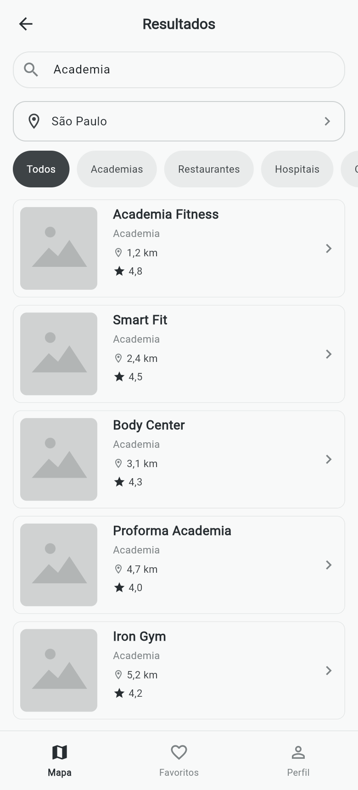

# Capturas do modo local

Capturas reais da versão Web compilada, em viewport de celular. O selo Modo local identifica a origem dos dados.

As imagens não comprovam integração com o Firestore nem execução física no Android. A documentação em TESTES.md registra as pendências.
